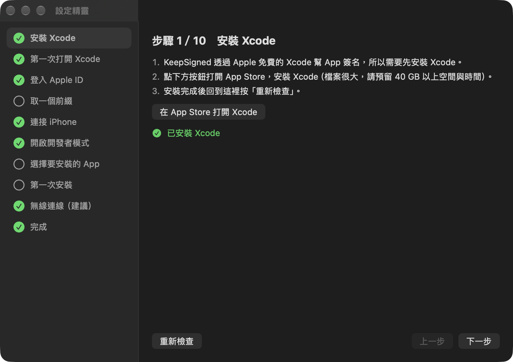

# KeepSigned

用免費 Apple ID 安裝到 iPhone 的 App，每 7 天就會過期打不開。KeepSigned 是一個 Mac 選單列小工具，會在到期前自動重新簽名，並透過 Wi-Fi 裝回你的 iPhone，你不用再自己處理。



- 不用寫程式：照著 10 步設定精靈操作就能完成。
- 不儲存帳號密碼：簽名使用你在 Xcode 登入的 Apple ID。KeepSigned 只讀取 Team ID。
- 只用 Apple 官方工具（`xcodebuild`、`devicectl`），不用第三方簽名服務。
- 會自動更新到新版。

> KeepSigned 只能安裝「有提供原始碼的 App 專案」（`.xcodeproj` 或 `.xcworkspace`），不能安裝從網路下載的 `.ipa` 檔。

## 需要準備

- 一台 Mac，系統為 macOS 15 以上，至少有 40 GB 可用空間（Xcode 很大）
- iPhone 或 iPad，以及一條傳輸線（第一次設定時要用）
- 一個 Apple ID（免費帳號即可）
- 要安裝的 App 專案資料夾，由 App 作者提供。可以先用本專案附的 `SampleApp/` 練習。

## 安裝 KeepSigned

有兩種方式，擇一即可。

### 方法一：用指令安裝（推薦，不會跳出警告）

1. 打開「終端機」（在「應用程式 → 工具程式」裡，或按 ⌘ 空白鍵搜尋「終端機」）。
2. 複製下面三行，貼上後按 Enter：

   ```sh
   curl -fL -o /tmp/KeepSigned.zip https://github.com/liaw-boy/KeepSigned/releases/latest/download/KeepSigned.zip
   ditto -x -k /tmp/KeepSigned.zip /Applications
   open /Applications/KeepSigned.app
   ```

   這三行依序做三件事：從本專案的 GitHub Releases 下載最新版，解壓到「應用程式」資料夾，然後打開 KeepSigned。

### 方法二：用瀏覽器下載

1. 到 [Releases](https://github.com/liaw-boy/KeepSigned/releases/latest) 下載 `KeepSigned.zip`。
2. 打開壓縮檔，把 `KeepSigned.app` 拖到「應用程式」資料夾。
3. 第一次打開時，macOS 會說「無法驗證開發者」。處理方式：
   1. 先按「完成」關掉提示。
   2. 打開「系統設定 → 隱私權與安全性」，滑到最下面，在 KeepSigned 旁邊按「仍要打開」。
   3. 輸入 Mac 密碼確認。之後就不會再詢問。

### 為什麼會有「無法驗證開發者」？為什麼用指令就不會？

- KeepSigned 沒有付費的 Apple 開發者簽章（Developer ID），macOS 認不出開發者是誰。
- 用**瀏覽器**下載的檔案會被加上「隔離標記」，macOS 看到這個標記，第一次打開時就會跳出警告，請你確認。
- 用 **`curl` 指令**下載的檔案不會被加上這個標記，所以不會跳出警告。這是 macOS 本來的行為，不是破解。
- 不論用哪種方式安裝，之後的**自動更新**都會先驗證本專案的簽章，簽章不符就拒絕安裝，請見 [SECURITY.md](SECURITY.md)。
- 請只從本專案的 GitHub Releases 下載 KeepSigned，**不要對來路不明的 App 使用這些方法**。

如果已經用瀏覽器下載、不想去系統設定，也可以在終端機執行下面這行，手動拿掉隔離標記：

```sh
xattr -dr com.apple.quarantine /Applications/KeepSigned.app
```

### 打開之後

螢幕上方的選單列會出現**印章圖示**，設定精靈也會自動跳出來。

## 設定精靈：10 個步驟

精靈每一步都會實際檢查，完成的步驟會打勾。不確定有沒有做好時，按「重新檢查」。

1. **安裝 Xcode**：從 App Store 安裝。檔案很大，需要一段時間。
2. **第一次打開 Xcode**：同意授權條款。跳出平台選項時，勾選 iOS 並安裝。
3. **登入 Apple ID**：在 Xcode 點 Settings → Accounts → 左下角「+」→ Apple ID，登入你的帳號。Team ID 通常會自動偵測。
4. **取一個前綴**：例如 `dev.bluefox`，你的所有 App 都會共用。請取一個跟真名、帳號無關的代號，**定了之後不要再改**。
5. **連接 iPhone**：用傳輸線接上，解鎖 iPhone，按「信任」並輸入手機密碼。
6. **開啟開發者模式**：在 iPhone 打開「設定 → 隱私權與安全性 → 開發者模式」，開啟後手機會重新開機。
7. **選擇要安裝的 App**：選 App 作者給你的 `.xcodeproj` 檔案。
8. **第一次安裝**：按「安裝到 iPhone」。裝好後，在 iPhone 打開「設定 → 一般 → VPN 與裝置管理」，點你的 Apple ID，再點「信任」。
9. **無線連線（建議）**：在 Xcode 點 Window → Devices and Simulators，選你的 iPhone，勾選「Connect via network」。之後不用接線也能續簽。
10. **完成**：打開「登入時自動啟動」。

## 日常使用

- 點選單列的印章圖示，可以看到每個 App 還剩幾天。
- KeepSigned 每小時檢查一次，到期前 2 天會自動續簽並安裝，失敗時會跳通知。
- 自動續簽時，**Mac 要開著**，iPhone 要跟 Mac 在同一個 Wi-Fi（或接著線）。
- 想馬上續簽，按 App 旁邊的「立即續簽」。
- 印章中間的勾變成驚嘆號，代表有 App 不到 1 天就要過期，或上次續簽失敗。

## 免費 Apple ID 的限制

這些是 Apple 的規定，KeepSigned 無法繞過：

- 簽名每 7 天到期，所以才需要 KeepSigned 自動續簽。
- 同一台 iPhone 最多同時裝 3 個自簽 App。
- 每 7 天最多建立 10 個新的 App ID。
- 推播通知等部分功能，免費帳號不能使用。

## 常見問題

**續簽失敗怎麼辦？**
在選單點「開啟紀錄檔」查看詳細訊息。最常見的原因：
- iPhone 鎖著
- iPhone 跟 Mac 不在同一個網路
- Xcode 登出了 Apple ID

**這樣安全嗎？**
KeepSigned 不儲存、也不傳送你的 Apple ID 或密碼，所有動作都在你的 Mac 上執行。自動更新只接受用專案金鑰簽過章的版本。詳見 [SECURITY.md](SECURITY.md)。

**檢查更新時出現錯誤？**
請確認 Mac 有連上網路，稍後再按一次選單裡的「檢查更新…」。更新檔放在 GitHub，GitHub 暫時連不上時也會出現這個錯誤。

**可以用來安裝任何 App 嗎？**
不行。只能安裝有原始碼專案的 App，而且請只安裝你信任的來源。

## 開發者

```sh
brew install xcodegen
xcodegen generate
xcodebuild test -project KeepSigned.xcodeproj -scheme KeepSigned -destination 'platform=macOS'
```

讓自己的 App 能被 KeepSigned 續簽：把 Bundle ID 設成 `$(BUNDLE_ID_PREFIX).yourapp`，並使用 Automatic signing。KeepSigned 會在建置時帶入每位使用者的前綴與 Team ID，專案裡不需要任何個人設定，可參考 `SampleApp/project.yml`。

發版流程：
1. 更新 `VERSION`，並在 `CHANGELOG.md` 新增該版本的段落（用 `- ` 開頭的條列）。這些條列會直接顯示在 App 的更新視窗裡。
2. 執行 `scripts/release.sh`。
3. 把 `dist/` 裡的 `KeepSigned-<版本>.zip`、`KeepSigned.zip`、`appcast.xml` 上傳到 GitHub Release `v<版本>`。

## 授權

[MIT](LICENSE)
